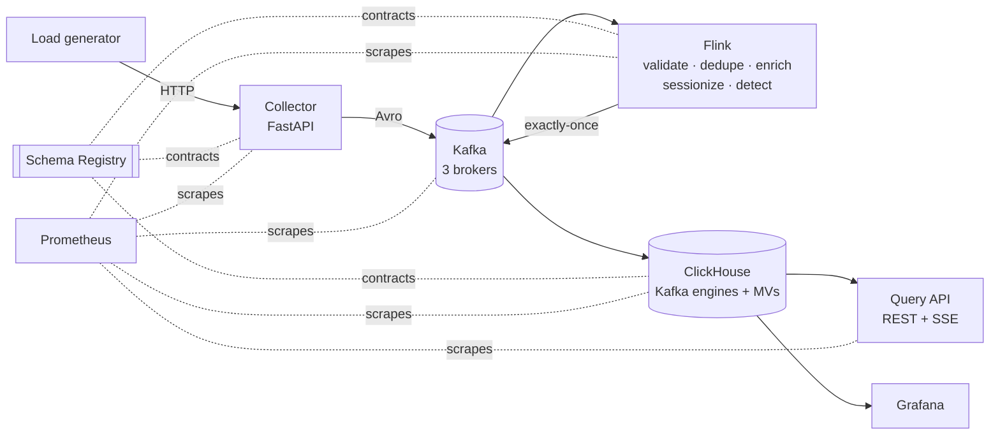

# Pulse: a real-time analytics platform

Pulse turns a live stream of e-commerce events into queryable metrics within seconds:
- revenue, conversion funnels, sessions, top products;
- real-time fraud alerts.

It is built on a stack widely used for this job at large organizations, at a size that runs on a laptop:

**Kafka → Flink → ClickHouse**, with Avro data contracts, exactly-once processing, a dead-letter path, Prometheus and Grafana observability, and tests at every layer.



## The stack and why

| Layer | Technology | Why it is the industry default |
|---|---|---|
| Event log | **Apache Kafka 4.3** (KRaft, 3 brokers) | Created at LinkedIn ([powered by](https://kafka.apache.org/powered-by)); the standard durable, replayable event backbone. KRaft removes ZooKeeper. |
| Data contracts | **Avro + Confluent Schema Registry 8.3** | Schema evolution with enforced compatibility; natively understood by Flink and ClickHouse. |
| Stream processing | **Apache Flink 2.2** (Java 17, RocksDB) | Stateful, event-time, exactly-once processing. Listed users include Alibaba, Uber and Pinterest ([powered by](https://flink.apache.org/what-is-flink/powered-by/)). |
| Real-time OLAP | **ClickHouse 26.8 LTS** | Columnar SQL engine built for fast aggregations over large datasets, with direct Kafka ingestion. Adopters include Cloudflare, Uber and eBay ([adopters](https://clickhouse.com/docs/about-us/adopters)). |
| Services | **Python 3.13, FastAPI, Pydantic, uv** | Typed, async, OpenAPI-documented services; `uv` for locked, reproducible environments. |
| Observability | **Prometheus 3 + Grafana 13** | CNCF-standard metrics, alerting and dashboards, all provisioned as code. |
| Delivery | **Docker Compose, GitHub Actions, Dependabot** | One-command local platform; CI runs unit, integration and end-to-end tests. |

Everything is open source or free to self-host. No account, licence key or cloud subscription is needed to run any part of it (Docker Desktop is free for personal use). The reasoning behind each choice, with the alternatives considered, is in [docs/adr](docs/adr).

## Quick start

**Prerequisites:** Docker Desktop (or Docker Engine with Compose v2) with about 12 GB of memory available to containers. This is an estimate: the configured Kafka, Schema Registry and Flink JVM sizes alone add up to about 6 GB. Nothing else is needed: Java and Python builds run inside Docker.

```bash
docker compose up -d --build
```

The first build takes a few minutes. Then wait until data flows end to end (or watch `docker compose ps`):

```bash
bash scripts/wait-for-stack.sh
```

The load generator starts automatically: 60 simulated shoppers, one fraud bot, and a trickle of deliberately broken records. Open Grafana and watch it fill in.

| Component | URL | Credentials |
|---|---|---|
| Grafana: business and platform dashboards | http://localhost:3000 | `admin` / `admin` |
| Query API: interactive OpenAPI docs | http://localhost:8001/docs | none |
| Collector API | http://localhost:8000/docs | header `X-API-Key: dev-write-key` |
| Kafka UI: topics, messages, schemas, consumer lag | http://localhost:8080 | none |
| Flink dashboard: job graph, checkpoints, backpressure | http://localhost:8082 | none |
| ClickHouse SQL console | http://localhost:8123/play | `query_api` / `query-api-dev` (read-only) |
| Prometheus: metrics and alerts | http://localhost:9090 | none |
| Schema Registry REST | http://localhost:8081/subjects | none |
| Kafka (host clients) | `localhost:19092,localhost:19093,localhost:19094` | PLAINTEXT |

All credentials are development defaults; override them in `.env` (see [.env.example](.env.example)).

Stop with `docker compose down`, or `docker compose down -v` to also delete the data.

## Try it

Send an event:

```bash
curl -s -X POST localhost:8000/v1/events -H 'X-API-Key: dev-write-key' -H 'Content-Type: application/json' -d '{
  "event_id": "6f1c2a1e-1111-4c3b-9a7e-000000000001", "event_type": "purchase",
  "event_time": "2026-10-10T12:00:00Z", "user_id": "u-demo", "session_id": "s-demo",
  "page_url": "https://shop.example.com/checkout", "product_id": "P0001",
  "quantity": 1, "unit_price_cents": 2599, "order_id": "o-demo", "country": "NL", "device": "mobile"}'
```

Use a current `event_time`: the collector rejects timestamps more than 5 minutes ahead of, or 7 days behind, its clock. Sending the same body twice is safe; the pipeline de-duplicates on `event_id`.

Query the serving layer:

```bash
curl -s 'localhost:8001/v1/overview?window=15m'
curl -s 'localhost:8001/v1/funnel?window=1h'
curl -s 'localhost:8001/v1/top-products?window=1h&by=revenue'
curl -N 'localhost:8001/v1/live'          # Server-Sent Events, one KPI snapshot every 2 s
```

Or ask ClickHouse directly at http://localhost:8123/play:

```sql
SELECT minute, sum(revenue_cents) / 100 AS revenue, uniqMerge(users) AS users
FROM pulse.metrics_minute
WHERE minute > now() - INTERVAL 15 MINUTE
GROUP BY minute ORDER BY minute;
```

Break things on purpose: stop a Kafka broker, kill a TaskManager, take Schema Registry down. The [runbook](docs/runbook.md#chaos-drills) lists what should happen in each case.

## What it demonstrates

**Correctness under real-world conditions**
- Exactly-once processing: Flink checkpoints plus transactional Kafka sinks, with ClickHouse reading `read_committed`.
- Idempotent ingestion: client retries are de-duplicated on `event_id` in keyed state with a TTL.
- Event-time processing with watermarks. The watermark is clamped against the server clock, so one bad client clock cannot make every other event "late".
- A dead-letter path that keeps the original bytes and failure context, and is queryable in SQL. Transient failures (such as a registry outage) are retried, never dead-lettered.
- An honest statement of each hop's guarantee: [ADR-0005](docs/adr/0005-delivery-semantics.md).

**Data engineering practice**
- Data contracts: Avro schemas in one place. Java code is generated from them; they are registered with `BACKWARD` compatibility before any producer runs, and producers cannot auto-register.
- Declarative platform state: topics (`infra/kafka/topics.yaml`), versioned forward-only ClickHouse migrations with drift detection, dashboards generated from code, alert rules as code.
- Storage design:
  - ReplacingMergeTree for event tables.
  - AggregatingMergeTree minute rollups maintained at insert time.
  - Partitioning and TTLs, bloom-filter skip indexes.
  - Least-privilege read-only users with query limits and quotas.

**Software engineering practice**
- Typed services (strict mypy, Pydantic) with SQL-injection-proof query building: values are bound server-side, and choices come from allow-lists.
- Graceful degradation: bounded queues, `503 Retry-After` under backpressure, readiness and liveness probes, non-root containers, multi-stage builds.
- Observability by default: RED metrics on every service, custom Flink data-quality counters, consumer lag, and pipeline latency measured from collector to ClickHouse.

## Repository layout

```
schemas/avro/              Avro data contracts (single source of truth) + validation rules
services/collector/        Edge ingestion API (FastAPI -> Kafka)
services/query-api/        Serving API over ClickHouse (REST + SSE)
processing/stream-processor/  Flink job (Java): triage, dedupe, enrich, sessionize, alert
tools/platform-init/       Idempotent bootstrap: topics, schemas, migrations, catalog seed
tools/load-generator/      Simulated shoppers + controlled chaos
infra/kafka/               Topic definitions
infra/clickhouse/          Server config, users, versioned migrations
infra/prometheus/          Scrape config and alert rules
infra/grafana/             Datasources, dashboards (generated by generate_dashboards.py)
tests/e2e/                 End-to-end tests against the running stack
docs/                      Architecture, ADRs, runbook
```

## Testing

| Level | What | Command |
|---|---|---|
| Unit (Python) | Validation rules, API behaviour, SQL parameterisation, migrations, simulator | `cd services/collector && uv run pytest` (each project) |
| Operator (Flink) | Each function with real state and timers, using Flink's test harnesses | `make test-java` |
| Integration (Flink) | The whole topology on an embedded MiniCluster | `make test-java` |
| End-to-end | Dedupe, enrichment, DLQ, alerts, sessions and the API through the real stack | `make e2e` |
| Static | ruff, strict mypy, compose validation, promtool, dashboards-as-code drift check | CI |

`make test` runs all Python and Java tests. Java runs in a Maven container if `mvn` is not installed. CI ([.github/workflows/ci.yml](.github/workflows/ci.yml)) runs everything, including the full end-to-end suite against a fresh `docker compose` stack.

## Going to production

The local topology maps directly onto standard Kubernetes operators:
- Strimzi for Kafka;
- the Flink Kubernetes Operator with HA and S3 checkpoints;
- the Altinity ClickHouse Operator with replicated tables on ClickHouse Keeper.

See [docs/architecture.md](docs/architecture.md#production-topology-where-this-goes-next). Natural next steps: TLS/SASL everywhere, secrets from Vault or External Secrets, OpenTelemetry tracing across the collector and query API, and tiering cold data to Iceberg on object storage.

## Licence

[MIT](LICENSE)
