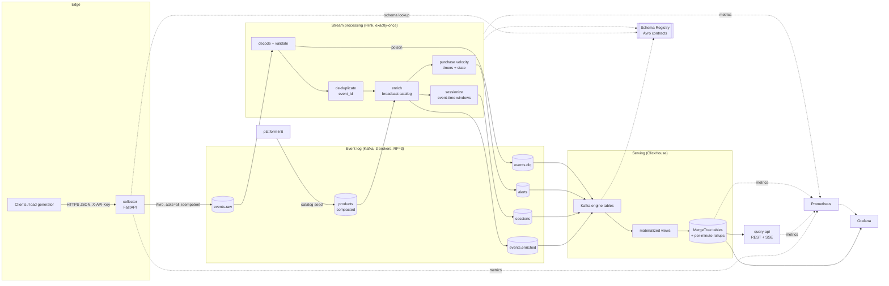

# Architecture

Pulse is a Kappa-style real-time analytics platform. Every event is written once to a durable, replayable log (Kafka). Everything downstream is derived from that log and can be rebuilt by replaying it.

## Data flow

1. **Ingest.** The collector authenticates the write key and validates each event against the contract (schemas/README.md). It serializes the event to Avro using the schema registered for `events.raw-value`, then produces it keyed by `user_id` (`acks=all`, idempotent producer). It returns `202` only after the broker acknowledges, so an accepted event is on three brokers. Under backpressure it sheds load with `503 Retry-After`. It never buffers events without bound.
2. **Process.** The Flink job reads `events.raw` and:
   - **Triage:** decodes and validates each record. Poison records keep their original bytes and go to `events.dlq` with `dlq.*` headers. Transient failures (for example, Schema Registry is unreachable) fail the task so Flink retries; they are never dead-lettered.
   - **De-duplicates** on `event_id` with keyed state and a TTL. Client retries are safe end to end.
   - **Enriches** each event with the product catalog. The catalog is a compacted topic held in broadcast state.
   - **Sessionizes** in event time with session windows (inactivity gap). The watermark is clamped by `received_at`, so a client with a wrong clock cannot advance it.
   - **Detects** purchase bursts (≥ N orders/minute per user) with keyed state and event-time timers. Alert IDs are deterministic, so a replay is idempotent.
   - **Writes** all outputs through transactional Kafka sinks that commit with each checkpoint (exactly-once).
3. **Serve.** ClickHouse consumes the output topics through Kafka table engines (`read_committed`). Materialized views write the rows into ReplacingMergeTree tables and maintain an AggregatingMergeTree per-minute rollup at insert time. The query API and Grafana read from these tables. Headline KPIs come from the rollup, so query cost scales with the time range, not with event volume.

## Guarantees

| Property | How |
|---|---|
| No acknowledged event is lost | `acks=all`, `min.insync.replicas=2`, RF=3, idempotent producer, 202 only after broker ack |
| Client retries never double-count | `event_id` idempotency key, de-duplicated in Flink keyed state |
| Processing is exactly-once | Flink checkpoints + Kafka transactions; consumers read `read_committed` |
| ClickHouse ingestion is effectively once | Kafka engine is at-least-once on crash; ReplacingMergeTree keys + `FINAL` absorb replays (see ADR-0005) |
| Bad data never stops the pipeline | Decode/contract failures go to `events.dlq` → `pulse.dead_letters`; parse failures in ClickHouse go to `pulse.ingest_errors` |
| Contracts cannot drift | Schemas registered by `platform-init` with `BACKWARD` compatibility; producers cannot auto-register |
| Everything is reproducible | Topics, schemas, migrations, dashboards and alert rules are all files in this repo |

## Components and ports

| Component | Role | Local URL |
|---|---|---|
| collector | Edge ingestion API | http://localhost:8000/docs |
| Kafka ×3 (KRaft) | Durable event log | `localhost:19092,19093,19094` |
| Schema Registry | Avro contracts | http://localhost:8081/subjects |
| Kafka UI | Browse topics, messages, consumer lag, schemas | http://localhost:8080 |
| Flink (1 JobManager, 2 TaskManagers) | Stateful stream processing | http://localhost:8082 |
| ClickHouse | Real-time OLAP store | http://localhost:8123/play |
| query-api | Typed analytics API + live SSE feed | http://localhost:8001/docs |
| Grafana | Business and platform dashboards | http://localhost:3000 |
| Prometheus | Metrics and alert rules | http://localhost:9090 |

## Production topology (where this goes next)

The compose stack is laid out like a production deployment. On Kubernetes the same artefacts map to standard operators:

| Here | Production equivalent |
|---|---|
| `kafka-1..3` containers, `topics.yaml` | Strimzi `Kafka` + `KafkaTopic` resources, or a managed Kafka service |
| `jobmanager` / `taskmanager` in application mode | Flink Kubernetes Operator `FlinkDeployment`, Kubernetes HA, S3 checkpoints |
| single `clickhouse` | Altinity ClickHouse Operator: `ReplicatedMergeTree` on ClickHouse Keeper, sharded |
| `platform-init` job | A Kubernetes `Job` / Argo CD sync hook in the deploy pipeline |
| `.env` dev credentials | External Secrets / Vault; TLS + SASL on Kafka, TLS on ClickHouse |
